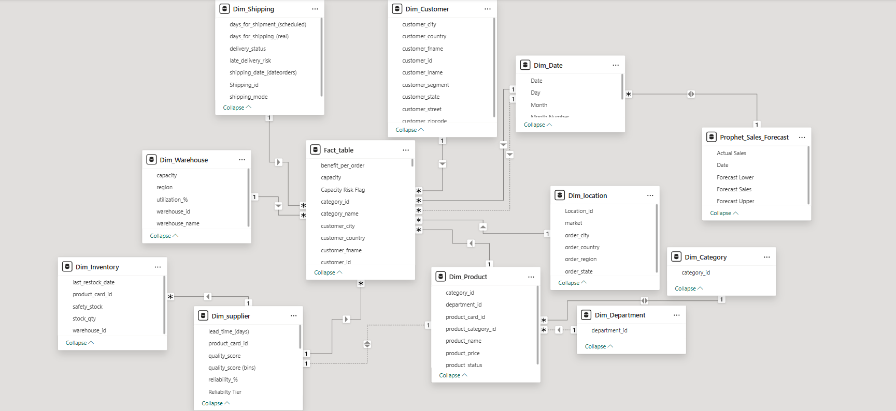
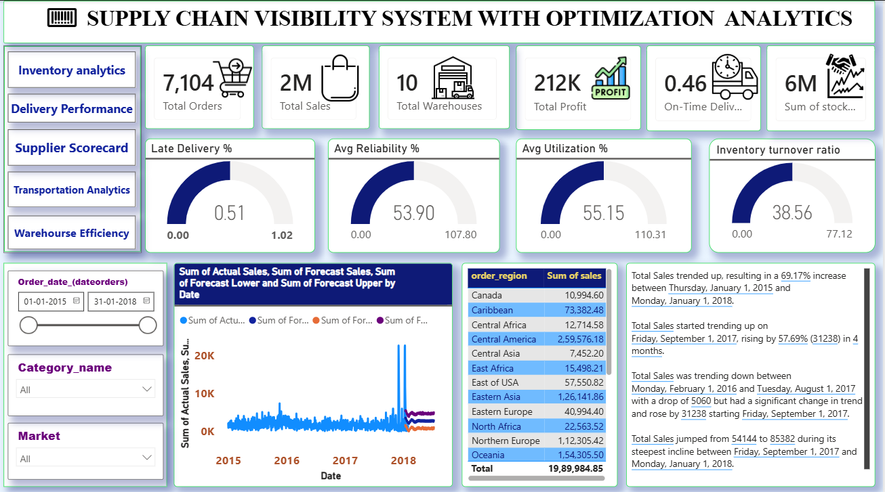
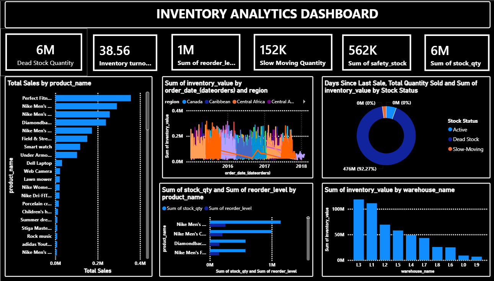
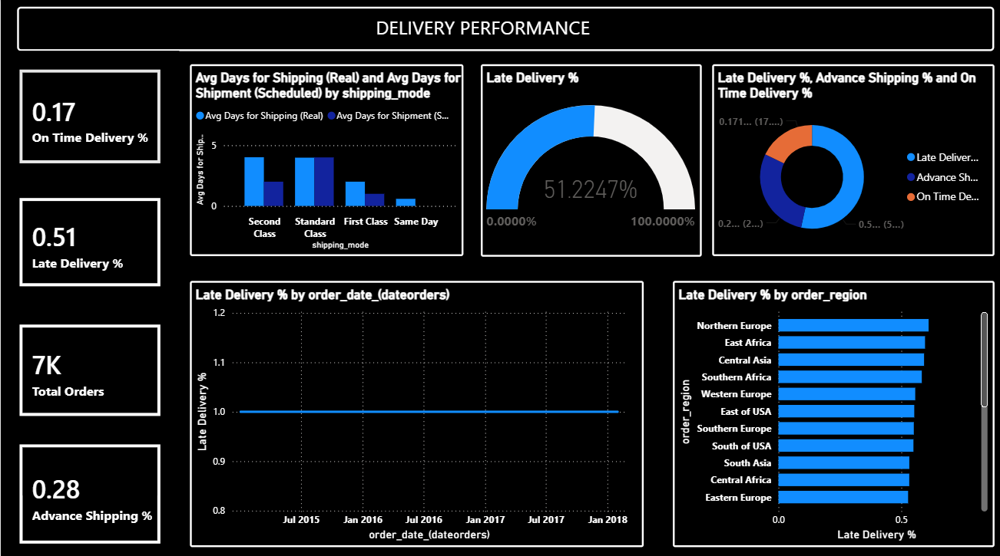
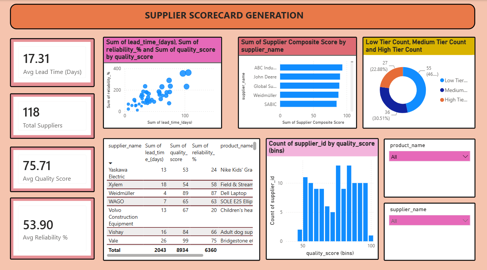
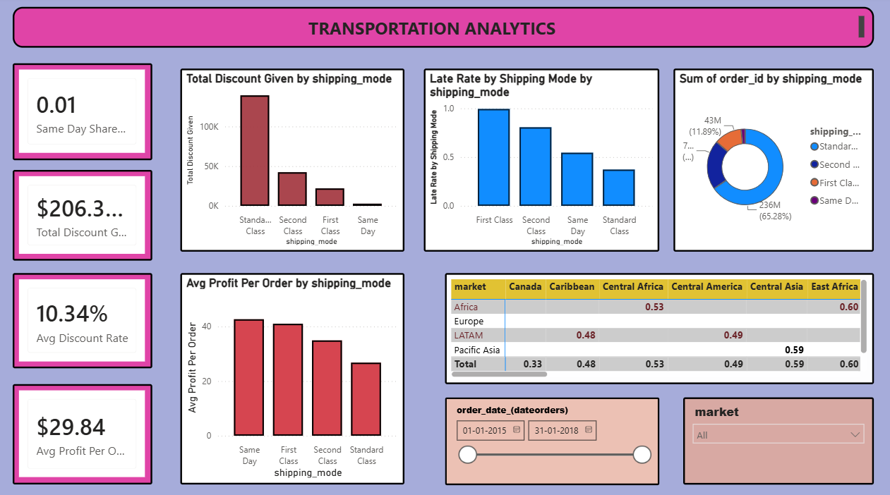
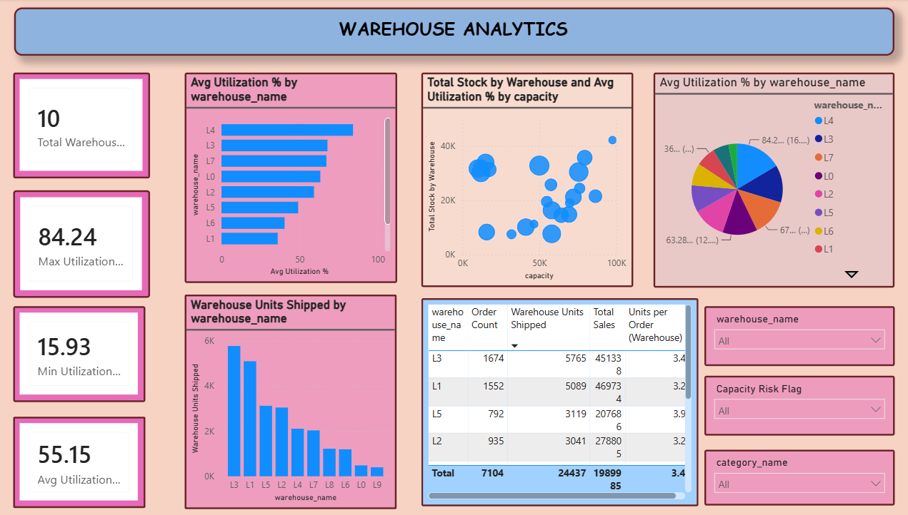

# Supply Chain Visibility & Optimization

An end-to-end Power BI analytics project that gives one view of a supply chain: sales, delivery, inventory, suppliers, transportation and warehouses, plus a sales forecast.

Built during the **Infosys Springboard Virtual Internship 7.0** on the DataCo Supply Chain dataset (Kaggle).

---

## 🎯 Problem Statement

Supply chain data sits in separate places, so it is hard to see where deliveries run late, where stock is stuck, which suppliers are weak and which warehouses are close to capacity. This project brings it into one star-schema model and a set of dashboards that answer those questions.

---

## 🧰 Tech Stack

| Area | Tool |
|------|------|
| BI and visualization | Power BI Desktop |
| Calculations | DAX (68 measures, calculated columns) |
| Data prep | Power Query |
| Database | PostgreSQL (Neon) |
| Forecasting | Python, Prophet |
| Version control | Git and GitHub |

---

## 🗂️ Data Model

Star schema with `Fact_table` at the centre and dimension tables around it:

`Dim_Customer` · `Dim_Product` · `Dim_Category` · `Dim_Department` · `Dim_Location` · `Dim_Shipping` · `Dim_Date` · `Dim_Warehouse` · `Dim_Inventory` · `Dim_Supplier`

Extra table: `Prophet_Sales_Forecast` (Date, Actual Sales, Forecast Sales, Forecast Lower, Forecast Upper).

- **Size:** 10,000 order-item rows, 7,104 orders, 5,576 customers, 87 products, 41 categories, 118 suppliers, 23 warehouses
- **Period:** Jan 2015 to Jan 2018



---

## 📊 Dashboards

| # | Page | What it shows |
|---|------|---------------|
| 1 | **Executive Dashboard** | Sales, profit, orders, on-time rate, stock, warehouse count, gauges, sales forecast |
| 2 | **Inventory Analytics** | Stock level, turnover, slow and dead stock, reorder levels |
| 3 | **Delivery Performance** | Late, on-time and advance shipping, regional late rate, scheduled vs real days |
| 4 | **Supplier Performance** | Reliability tiers, quality, lead time, composite score |
| 5 | **Transportation Analytics** | Shipping mode, discount, profit per order, late rate by mode |
| 6 | **Warehouse Efficiency** | Utilization, capacity risk, units shipped, units per order |
| 7 | **Order Details** | Order-level table for drill-through |

### Screenshots

| | |
|---|---|
|  |  |
|  |  |
|  |  |

---

## 🧮 Key DAX Logic

**Delivery**
```DAX
Late Delivery % =
DIVIDE ( CALCULATE ( DISTINCTCOUNT ( Fact_table[order_id] ),
         Fact_table[delivery_status] = "Late delivery" ), [Total Orders], 0 )

Lead Time Variance (Days) = [Avg Days for Shipping (Real)] - [Avg Days for Shipment (Scheduled)]
Fulfillment Rate = DIVIDE ( [Total Orders] - [Canceled Orders], [Total Orders], 0 )
```

**Inventory**
```DAX
Stock Status =
VAR DaysIdle = Fact_table[Days Since Last Sale (Col)]
VAR Qty = Fact_table[stock_qty]
RETURN SWITCH ( TRUE (),
    Qty = 0, "Out of Stock",
    DaysIdle > 90 && Qty > 0, "Dead Stock",
    DaysIdle > 30 && DaysIdle <= 90, "Slow-Moving",
    "Active" )

Inventory turnover ratio = DIVIDE ( [Total Sales], [Avg inventory value], 0 )
MoM Inventory Value Change  -- uses DATEADD ( ..., -1, MONTH )
Reorder Flag                -- compares stock with reorder level and safety stock
```

**Supplier**
```DAX
Supplier Composite Score =
( quality_score * 0.4 ) + ( reliability_% * 0.4 )
+ ( ( 30 - lead_time_(days) ) / 30 * 100 * 0.2 )

Supplier Rank = RANKX ( ALL ( Dim_supplier ), [Supplier Composite Score], , DESC )

Reliability Tier = SWITCH ( TRUE (), reliability_% >= 80, "High",
                                      reliability_% >= 50, "Medium", "Low" )
```

**Warehouse**
```DAX
Avg Utilization % = AVERAGE ( Fact_table[utilization_%] )

Capacity Risk Flag =
VAR Util = [Avg Utilization %]
RETURN SWITCH ( TRUE (), Util >= 90, "Critical", Util >= 75, "Watch", "OK" )

Units per Order (Warehouse) = DIVIDE ( [Warehouse Units Shipped], [Order Count], 0 )
```

**Techniques used:** `CALCULATE`, `FILTER`, `ALLEXCEPT`, `SWITCH(TRUE())`, `RANKX`, `DATEADD`, `DATEDIFF`, `SAMEPERIODLASTYEAR`, `SUMX`, `MAXX`, `MINX`, `AVERAGEX`, variables.

---

## 🔮 Forecasting

- Daily sales history (Jan 2015 to Jan 2018) modelled with **Prophet**
- About six months ahead (mid Jan 2018 to mid Jul 2018)
- Lower and upper bounds shown as a range for planning
- Plotted with actual sales on the Executive Dashboard

---

## 💡 Key Insights

**Sales**
- Total sales about **$1.99M**, profit about **$212K**
- Largest markets: Pacific Asia (~$628K), Europe (~$571K), LATAM (~$481K)
- Largest region: Western Europe (~$307K)

**Delivery**
- **53.7%** of orders are late, 25.4% ship in advance, 17.4% on time, 3.4% cancelled
- Late risk by mode: First Class 99.7%, Second Class 79.9%, Same Day 56.6%, Standard Class 37.5%
- First Class takes about 2 days against 1 day scheduled

**Inventory**
- **70 of 87 products** are Dead Stock (no sale for more than 90 days)
- Reorder flags and safety-stock checks help catch low stock

**Suppliers**
- 118 suppliers, average reliability about **54%**, quality about **76**, lead time about **17 days**
- Composite score ranks suppliers so weak ones are easy to spot

**Warehouses**
- 23 warehouses, average utilization **55%**
- Critical: WH004 (98%) and WH017 (92%)
- Under-used: WH011 (12%), WH009 (14%), WH018 (17%)

---

## 🚀 Recommendations

- Rebalance stock from under-used warehouses to those at 90%+ utilization
- Review First Class and Second Class delivery promises, since they miss the most
- Clear or discount dead stock and slow-moving products
- Shift orders to suppliers with a higher composite score
- Use the forecast to plan reorders and warehouse space

---

## 📁 Repository Structure

```
SupplyChain_Visibility_Optimization/
├── README.md
├── Milestone 2/
│   └── Milestone2_PowerBI.pbix
├── Milestone 3/
│   └── Milestone3_PowerBI.pbix
├── Milestone 4/
│   ├── Milestone4_PowerBI.pbix
│   ├── Screenshots/
│   └── README.md
├── Power Bi/
│   └── Supply_Chain_Visibility_Optimization.pbix
├── Data/
│   ├── Fact_table.csv
│   ├── Dim_Supplier.xlsx.csv
│   └── Prophet_Sales_Forecast.csv
├── Screenshots/
│   ├── Executive_Dashboard.png
│   ├── Inventory_Analytics.png
│   ├── Delivery_Performance.png
│   ├── Supplier_Performance.png
│   ├── Transportation_Analytics.png
│   └── Warehouse_Efficiency.png
├── Documentation/
│   └── Data_Model.png
└── Presentation/
    └── Supply_Chain_Visibility_Optimization_FINAL.pptx
```

---

## ▶️ How to Open

1. Install Power BI Desktop
2. Download `Power Bi/Supply_Chain_Visibility_Optimization.pbix`
3. Open it in Power BI Desktop and refresh the data if asked (CSV files are in `Data/`)

---

## 👤 Author

**Nitish Kumar Yadav**
B.Tech CSE, Jagannath University, Jaipur
GitHub: [nitishkumarydv](https://github.com/nitishkumarydv)
